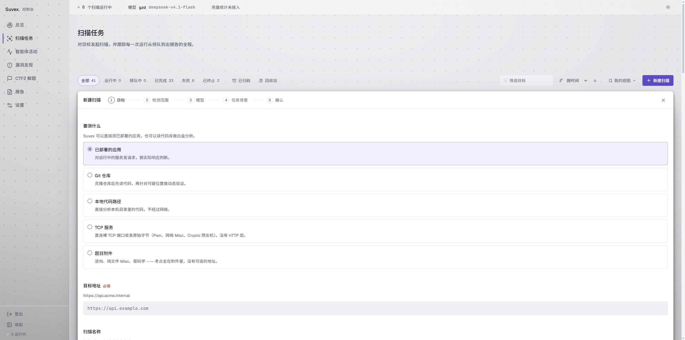
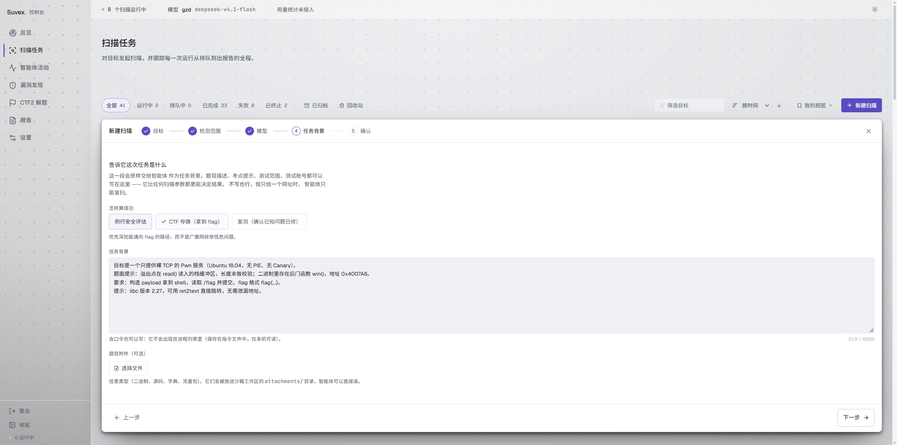
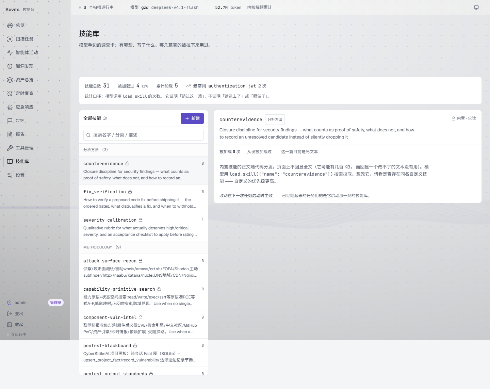
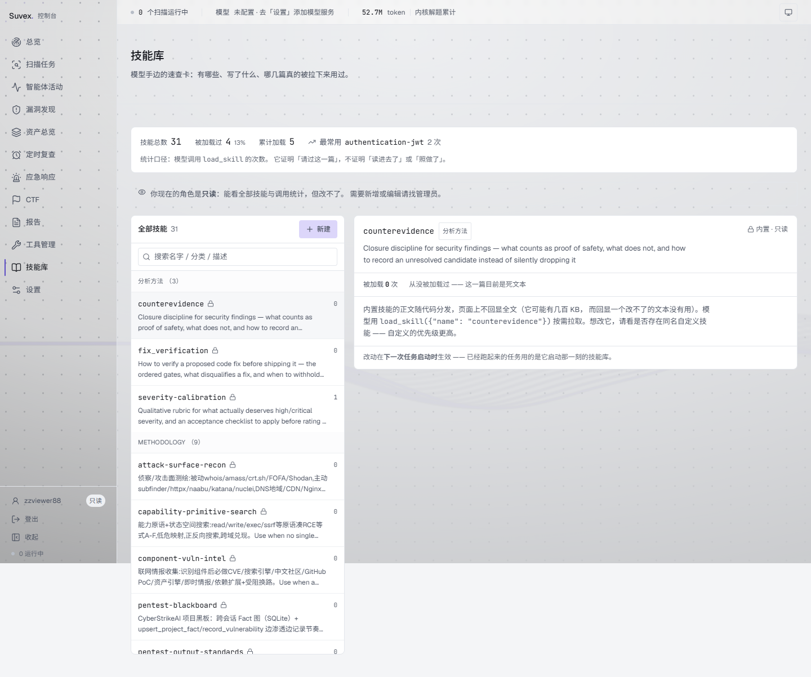
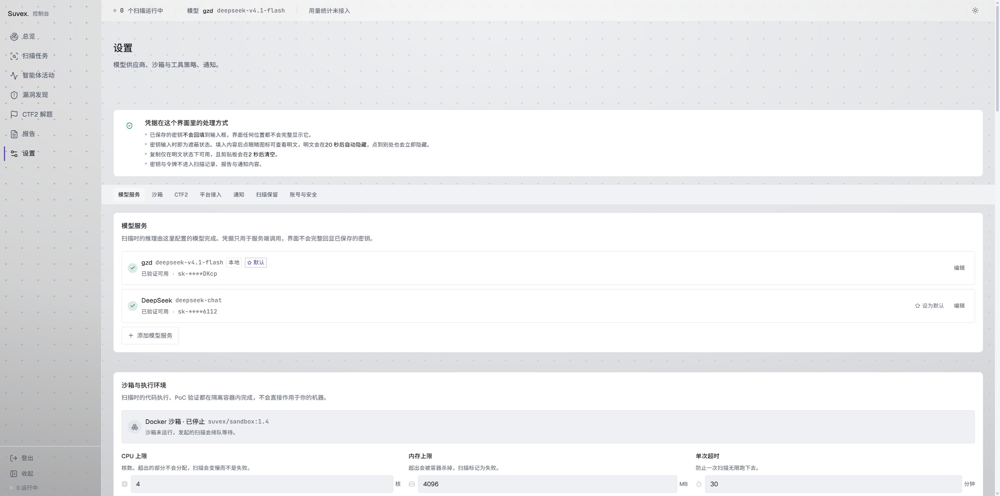

<div align="center">

# Suvex

**一个自治的 AI 安全测试平台**

给它一个目标 —— 网站、代码仓库、TCP 服务、CTF 题目附件 ——
它自己规划、调用工具、验证结论，最后交付一份可直接给人看的报告或题解。

[](https://github.com/Toyar-mo/Suvex/actions/workflows/ci.yml)
[](LICENSE)
[](suvex-api/)
[](suvex-web/)
[](suvex-web/docs/api-contract.md)

</div>

---

## 它是什么

传统扫描器输出的是**漏洞清单** —— 几百条按规则匹配的结果，其中大量是误报，没人知道哪条真的能打通。人工渗透测试输出的是**结论**，但一个人一周只能做一两个目标。

Suvex 的取舍是：**让 agent 像人一样去验证，然后只交付它真的确认过的东西。** 它的核心不是"扫得更多"，而是三件配套的事：

| 机制 | 解决的问题 |
| --- | --- |
| **执行留痕** | 每一次工具调用、推理、发现都进事件流并落库，报告的每条结论都能追到过程 |
| **证据分级** | 区分"确证"与"启发式"，拿不准的标 `needs_follow_up`，**不把猜测写成结论** |
| **判据可配** | `findVulns` / `captureFlag` / `verifyFix`，决定"怎样算成功" |

<div align="center">

<p><sub>新建扫描：已部署的应用 / Git 仓库 / 本地代码 / TCP 服务 / 题目附件 —— 五种目标，一条流水线</sub></p>
</div>

<div align="center">

<p><sub>任务背景：判据决定"怎样算成功" —— 例行评估 / CTF 夺旗 / 复测已修</sub></p>
</div>

---

## 两个入口

同一个 agent 内核，两种判据，两种产物。

| | 渗透评估 | CTF 夺旗 |
| --- | --- | --- |
| **输入** | 目标（已部署应用 / Git 仓库 / 本地代码 / TCP 服务）+ 任务背景（测试范围、测试账号、注意事项） | 题目附件 + 题面 |
| **成功判据** | `findVulns` —— 确认可复现的漏洞 | `captureFlag` —— 拿到 flag |
| **产物** | 漏洞报告，每条结论都能追到过程 | **题解（Writeup）** —— 一次夺旗的产物是"怎么想出来的"，不是"哪里有洞" |
| **之后发生什么** | 处置工作流：`new` → `confirmed` → `fixed` → `closed`，指派负责人、SLA 修复时限、按类型分组、附件存证、误报标记 | 候选 flag 交平台校验，解出后回填题解 |

第三档判据 `verifyFix` 用于**复测已修** —— 同一套流水线，把"怎样算成功"换成"漏洞是否还在"。

> [!NOTE]
> 判据是 `captureFlag` 时，服务端会把 agent 写的报告**重新分节**成题解版式，并把 flag 提到最前面。执行后端的报告标题与分节标题都是写死的渗透口径，所以这一步只能由我们做（详见 `suvex-api/app/scans/writeup.py` 的模块说明）。

---

## 技能库：模型手里那叠速查卡

模型不是靠"知道更多"变强的，是靠**在正确的时刻读到正确的那一篇**。技能库就是这个"叠卡"：31 篇随代码分发的 Markdown，每篇讲一件事该怎么做（怎么判一条证据够不够、某种漏洞怎么验、某个协议从哪下手）。模型用 `load_skill` 按需拉取，不需要全都塞进上下文。

技能库页回答三个问题：**有哪些、写了什么、哪几篇真的被拉下来用过。**

<div align="center">

<p><sub>技能库：左边是清单（按分类分组），右边是正文，顶部是调用统计 —— 0 次会明写"这一篇目前是死文本"</sub></p>
</div>

> [!IMPORTANT]
> **那个统计数字的口径必须说清楚，否则它会被读成"有用"。** 它统计的是模型调用 `load_skill` 的次数 —— **能证明"请过这一篇"，不能证明"读进去了"或"照着做了"**。一篇被拉了 3 次却毫无影响的技能，和一个从未被拉过的技能，在这张表上看起来是同一回事（都是低数字）。页面上把这句写在统计条下面，而不是留在文档里 —— 免得对着数字做过度解读。

技能分两种来源，界面上区别对待：

| 来源 | 存放位置 | 可改 | 界面上 |
| --- | --- | --- | --- |
| **内置** | `suvex-api/prompts/skills/<分类>/<名字>.md`，随代码分发 | 否 | 显示「内置 · 只读」，**根本不画**编辑/删除按钮 |
| **自定义** | 数据目录下的同名结构，部署时不会覆盖 | 是 | 可编辑、可删除、可新建 |

> [!NOTE]
> 内置技能为什么不做成"可改但会警告"：内置技能是**纪律的载体**（比如"一条命中在补对照实验之前只能算候选"）。能改它，就能通过一段文字让模型绕过某条纪律，而那种改动在事后完全看不出来 —— 技能正文不进任何执行日志。所以内置就只读，自定义才是可改的那一半。三种改动（新建/更新/删除）在审计里**分开记三条**，理由同此。

<div align="center">

<p><sub>只读角色：能看全部清单与正文，「新建」灰掉并说明原因，看不到编辑/删除 —— 而不是点了才 403</sub></p>
</div>

---

## 快速开始

### 后端

```bash
cd suvex-api
python -m venv .venv && . .venv/bin/activate
pip install -r requirements-dev.txt
cp .env.example .env                 # 生成 SUPEX_SECRET_KEY：python -m app.core.crypto
alembic upgrade head
uvicorn app.main:app --reload        # 服务在 http://127.0.0.1:8000
```

> [!NOTE]
> **API 文档页默认是关的。** `SUPEX_EXPOSE_DOCS` 默认 `false`，于是 `/api/v1/docs` 返回 **404** —— 这是刻意的，不是故障：那份文档描述**全部端点与出入参**，默认不该暴露。要在本机看，把它设成 `true` 再重启。
> 契约本身始终可读：[`suvex-web/docs/api-contract.md`](suvex-web/docs/api-contract.md)。

### 前端

```bash
cd suvex-web
npm install
npm run dev                          # http://localhost:5173
```

前端默认请求**当前页面的 origin**，由 Vite 的 `server.proxy` 把 `/api` 转发到后端。换地址访问、换机器部署都不需要改配置；同源请求，没有 CORS 问题，Cookie 也一定带得上。

### 一次跑起来（docker compose）

```bash
cd suvex-api && docker compose up --build
```

> [!WARNING]
> compose 镜像是**控制面**，跑不了扫描。实测确认容器里没有 `strix` 与 `docker` CLI；要跑扫描用 [`suvex-api/deploy/`](suvex-api/deploy/) 的宿主机部署。这是刻意的取舍 —— 控制面与执行面分离，跑扫描的那台需要 Docker 与目标网络。

### 真机部署（要真跑扫描，只有这一条路）

上面几条是开发路径 —— 跑测试、看界面。**要真的执行扫描**则只能走这条：一台装了 Docker 的 Linux 宿主机，按 [`suvex-api/deploy/`](suvex-api/deploy/) 部署，systemd + 宿主 venv，不用容器：

```bash
# 先在目标机上跑一遍 --dry-run：打印全部命令与将写入的内容，但不执行
sudo bash suvex-api/deploy/install.sh --dry-run
sudo bash suvex-api/deploy/install.sh
```

那套文档覆盖了：专用用户（不用 root）、**加 docker 组**（权限等价于 root，知情后再加；要真隔离得给 strix 配远程 docker 端点）、装锁文件而非 `requirements.txt`、生产必开的 `SUPEX_COOKIE_SECURE`（否则启动自检拒绝启动）、nginx 反代、日志与备份。装完按第七节验收。

<div align="center">

<p><sub>设置：模型供应商、Docker 沙箱、执行策略，一处管理</sub></p>
</div>

---

## 当前状态（如实说）

> 这一节是给评估方看的，不是宣传文案。已做到的附数字与口径，没做到的如实列出 —— **包括修过又漏、漏过又修的**。

### 规模

| 项 | 数字（2026-10-17 实测，换行符口径） |
| --- | --- |
| 后端代码 | **47,622 行** / 118 个文件（`suvex-api/app/`，不含 `__pycache__`），13 个领域模块 |
| 后端测试 | **75 个测试文件 / 1,352 个测试函数**，`parametrize` 展开后**实际执行 2,432 passed / 3 skipped / 0 failed**，对**真实 PostgreSQL** 跑（不是 SQLite），实测 42 分 35 秒 |
| 前端代码 | **45,624 行** / 162 个 `.ts`/`.tsx`（`suvex-web/src/`），**0 个 `@ts-ignore`、0 个 `any`**（本机工作区口径，与 [`DEPENDENCIES.md`](DEPENDENCIES.md) §5 同一次取数） |
| 前端测试 | **228 个 vitest 实际执行用例** / 14 个文件（静态 `it(` 是 216，差额来自写在 `for` 循环里的用例） |
| 数据库迁移 | 36 个 Alembic 版本，从第一个迁移就版本化 |
| API 端点 | 115 个（按 `@router.*` 装饰器计） |
| API 契约 | [`suvex-web/docs/api-contract.md`](suvex-web/docs/api-contract.md)，3,741 行，**唯一事实来源** |
| 决策记录 | 8 篇 ADR，每篇写**为什么**而不是**是什么** |
| CI | GitHub Actions 三个 job：后端（ruff + 测试）/ 前端检查 / 仓库卫生 —— 2026-10-11 首次全绿（run #9，`861f64a`，19m40s） |

> [!WARNING]
> **关于测试数字的口径**：表里同时给了静态数与实际执行数，两者**都要标清楚**。后端静态 `def test_` 是 **1,352**（75 个文件），`parametrize` 展开后实际执行 **2,432**；前端静态 `it(` 是 **216**（14 个文件），实际执行 **228** —— 差额来自 `route-guard.test.ts` 里 **6 处**把 `it()` 写在 `for` 循环内（`:62` `:90` `:117` `:135` `:150` `:159`）。**只写其中一个数都是错的**：只写静态数是 README 早先犯过的错，只写执行数则无法复核。
>
> 同样，"文件总行数"也写清口径：按换行符计数（与 `wc -l` 等价），含空行与注释。同一份代码在不同口径下能差一万行 —— 而一份"看起来精确"却对不上的数字比"大约四万行"更有害。
>
> 这些数字**会漂**。本 README 每次更正都会重测，但代码在动，文档跟不上是常态。你读到的数字如果与实测对不上，**以实测为准**。
>
> **复核命令不在这里重复写** —— 后端那几项的逐条量法在 [`suvex-api/README.md`](suvex-api/README.md) 的「这个后端现在是什么状态」表下面，依赖与代码行数的在 [`DEPENDENCIES.md`](DEPENDENCIES.md) 第三～五节。这是「设计原则」第 3 条在文档上的应用：同一件事实只留一个出处，抄两份迟早漂移。

### 真机验证过的

一台有 Docker 的 Kali 上部署后：

* 扫描编排 → 真 strix 子进程 → Docker 沙箱容器 → 事件导入，链路全通
* 单次扫描观测到 **936 条**事件，`agentCount` 从 0 涨上去
* CTF2 判题引擎实际解出过题目，flag 落库（如 `CTF2{e1775a04-…}`）

### 已经补上的

* **CI**：GitHub Actions 三个 job
* **LICENSE**：Apache 2.0，含专利授权条款
* **契约漂移**：v0.21 / v0.22 两轮专项对账
* **501 清零**：最后 6 个端点已实现
* **可观测性与生产部署物**：`/metrics` + systemd / nginx / 部署文档
* **多用户与两档角色**：管理员 / 只读，含防自锁规则
* **CTF 解题现场保留**：`/work/persist` 持久区（v0.34 修好权限）
* **附件内容指纹**：SHA256 三口径判重
* **提交证据门禁**：`auto` 模式无证据不提交
* **跨题方法卡与召回**：v0.29–v0.32
* **后端静态检查**：ruff 接进 CI（v0.35 —— 此前是"配了但从不运行"）
* **CTF 解题换模 fallback**：主 provider 调不动时切备用，不废掉已跑的轮次（v0.35）

### 还没有做到的

| # | 缺口 | 影响 |
| --- | --- | --- |
| 1 | **前端页面测试只覆盖了两个页** | 285 个用例里页面级只有 `LoginPage`（4）和 `OverviewPage`（5），其余仍靠组件与纯逻辑测试兜底。补这两页时撞到一件值得记的事：jsdom 不实现 `matchMedia` / `IntersectionObserver` / `ResizeObserver`，而 `PageHeader`（在 `AppShell` 里）和 `StatCard` 都用它们 —— 没补桩之前，**任何渲染到页面级的测试都会炸在 `window.matchMedia is not a function` 上，而那个报错看起来像被测组件的 bug**。桩已收进 `src/test/setup.ts`。**剩下 8 个页面仍零测试**（`ScansPage` 依赖 20+ 组件，最重），表单交互与主题切换也没有 —— 渲染期崩溃仍然只有人工点开页面才能发现 |
| 2 | **`/metrics` 不覆盖依赖注入抛出的 401/403** | 路由层返回的状态码都计数，但鉴权失败经异常处理器生成的不计（见 `test_metrics.py` 里那条钉住局限的用例） |
| 3 | **多用户是单租户的** | 多个账号共享全部数据。真多租户要每张业务表加 `tenant_id` 并把过滤条件写进所有查询 —— 而且 Suvex 会对任意目标发包，做 SaaS 意味着要为**别人**的扫描目标负责，那是合规问题，不只是技术问题 |
| 4 | ~~**扫描产物目录只增不减**~~ | ✅ **已修**（2026-10-16）：每次扫描在 `_scan_runs/<scan_id>/` 留下 5–7 MB（实测），按每天 20 次扫描估约 43 GB/年。它有**两个**来源，这次都堵上了 —— ① 数据库里已无记录的孤儿目录 → `sweep_orphan_artifacts`（2026-10-11 修的）；② ★ **记录还在、但早已归档**的目录 → `sweep_retired_artifacts`（判据是"已归档 + 归档时刻早于保留期"，**不用** `finished_at`，否则刚手工归档的会被立刻删；`retention_days = 0` 表示关闭）。保留期是设置页「扫描保留规则」的**第三个数字**（默认 90 天，与"归档 30 天 → 回收站删除 30 天"串成一条生命周期，产物清理排在最后因为它是唯一不可逆的一步） |
| 5 | **依赖锁定靠 pip-tools，不是 uv** | 这是**选型**不是缺口。`requirements.txt` 是声明，`requirements.lock` / `requirements-dev.lock` 是 pip-tools 生成的精确锁定（37 个包 + sha256），`Dockerfile` 装的是锁文件。真正的风险是**改了声明却忘记重新生成锁文件**（生成命令见 `requirements.txt` 头部，必须在 Linux 上生成）—— 这一条现在由 `suvex-api/scripts/verify_lockfiles.py` 拦着，CI 的 `hygiene` job 会跑。它查的是「声明里的包锁文件里有没有」和「锁定的版本满不满足声明的约束」，**不是**「重生成后有没有 diff」—— 后者会在上游每次发版时无故变红，红几次就被人关掉了（理由写在脚本头部） |
| 6 | **续解仍会丢"工具装到一半的状态"** | 持久区（`/work/persist`）已能跨次保留产物，但**镜像外的临时安装**（`pip install` 到系统目录、`apt` 装的包）仍然丢 —— 它们不在持久区里。**但它没看上去那么要紧**：实测库里 38 次解题只续解过 1 次（装包动作倒有 48 次，绝大多数在同一次尝试内就跑完了），所以这条的暴露面是一个次数量级的事件。真要修是给 `pip` 设 `PIP_TARGET` 指到持久区并加进 `PYTHONPATH`，`apt` 装的包仍无解 |
| 7 | **方法卡的效果**未经对照实验验证 | 提炼与召回已实现（`notes.py`，29 张卡已回填）。2026-10-13 做了首次 A/B 对照（n=1）：两组都跑满 40 轮、都未解出，过程指标差异很小（命令数 26 vs 23）—— **没有观察到正向信号，但 n=1 不构成结论** |
| 8 | ~~附件只按大小判重~~ | ✅ **已修**：`attachments.py` 加了 SHA256 指纹（`FINGERPRINT_SUFFIX`），三口径判重（大小 + 指纹 + 已存在） |
| 9 | ~~`auto` 模式提交前不校验证据~~ | ✅ **已修**：`decide_submission` 加了 `evidence=` 与 `saw_tool_output=` 两个门禁，无证据不提交 |

> [!NOTE]
> 第 4、8、9 条留着删除线而不是直接删掉，是因为**"曾经缺过什么"本身是信息**。评估方看的是"这个项目知不知道自己缺什么、改完之后有没有如实更新"，而一份总是干干净净的清单反而看不出这一点。
>
> ⚠️ 而且**引用缺口要引标题、不要引序号**：这份清单的编号变过（第 4 条原本是第 5 条 —— 版式重写时删掉了前面一条），而代码里曾按序号引用，于是 10 处注释在重编号后集体指错。现在代码里一律写「缺口清单『扫描产物目录只增不减』」。

---

## 设计原则

这个项目里反复出现的几条判断标准，写在最前面免得后来者推翻它们。

### 1. 宁可少说，不说错的

拿不到 flag 就写"本次没有确认到 flag"，而不是猜一个；证据分级里 `ruled_out` 必须附具体反例，"感觉应该没问题"一律记 `needs_follow_up`。

### 2. 失败要说人话，并且给出下一步

续跑失败不能只说"会话文件已不在" —— 必须补上"请改用「重跑」"。用户要的是结果，"不能做"本身不解决问题。

### 3. 同一件事实只能有一个出处

筛选条件、状态流转表、枚举词汇表都只有一份实现。两份口径迟早漂移，而漂移的症状（"列表 3 条、角标 7 条"）用户无法解释，只能不再相信界面。

### 4. 凭据只走环境变量

`.env` / `_uploads/` / `_scan_runs/` 全部不入库，见 `.gitignore` 的分节说明。`_uploads/` 那条尤其重要：附件是**用户上传的业务数据**（内网截图、抓包），可能含拓扑甚至演示时粘贴过的令牌。

### 5. 注释写"为什么"，不写"是什么"

代码本身说清了是什么；注释要留下的是**当时的取舍与踩过的坑**。所以你会看到大量"⚠️ 这里曾经……"的记录 —— 那是给下一个改这段代码的人看的。

### 6. 过程性文档不入库

交接文档、代码审查报告、修复工作单这类文件**曾经入过库**，2026-10-14 已从 git 历史中移除。理由不是"它们不好"，而是**它们的保质期与代码不同步**：

| | 代码注释 / README | 交接文档 |
| --- | --- | --- |
| 改动代码时 | 就在旁边，**会被顺手更新** | 没人记得去改 |
| 过期之后 | 编译/测试会暴露矛盾 | 静默变错，且看起来仍像权威 |
| 内容 | 一条可验证的取舍 | 大量"当时的"数字与环境细节 |

这个项目已经吃过一次亏：README 曾写「32,483 行」，而同一时刻 `app/` 实际是 39,163 行 —— 那个数字对不上**任何**口径。一份"看起来精确却对不上的数字"比"大约四万行"更有害，因为它让人以为核实过了。

所以那次移除时做了一件比"删文件"更重要的事：**先把文档里的知识搬到它约束的那段代码旁边**。例如「一次 `ReadError` 作废了 14 轮」写进了 `app/settings/models.py` 里那个 fallback 字段的注释（它正是为此而加的）；「别顺手格式化、制造无关 diff」写进了 `suvex-api/pyproject.toml` 的 ruff `exclude` 注释，以及下面这条。

⚠️ 确实需要交付某份文档时**走交付目录**，不要 `git add -f` 绕开 `.gitignore` —— 那会让这条规则形同虚设。

### 7. 不做与本次改动无关的修改

`ruff format` 会让整个仓库变红（HEAD 版本与多个未改动文件都过不了），但项目**只用 `ruff check`**。顺手格式化会产出几十个无关文件的 diff，把真正的改动淹没在里面 —— 评审时看不出改了什么。

---

## 案例：CTF 解题能力的环境根因整改

> 这一节是「设计原则」的一次完整应用。留着它，是因为它展示了**这个团队是怎么定位问题的**。

一次针对"难题为什么解不出"的实测（2026-10-12），把三个**环境层缺口**找了出来并补上。它们的共同特征是：**看起来像模型能力问题，实际是环境缺东西**。

| 缺口 | 怎么发现的 | 补法 |
| --- | --- | --- |
| **镜像里没有任何 .NET 工具** | 清点镜像：`mono`/`dotnet`/`ILSpy` 全无。而一道已记录的失败题 `[FlareOn3]GUI` 正是 .NET | `mono-runtime` + `mono-devel`（带 `monodis`） |
| **没有 X Server** | 在真实附件上试 `mono GUI.exe`，**崩在 `Application.EnableVisualStyles()`**：`Could not open display` | `xvfb` + `xauth` + `x11-utils` |
| **没有 `numpy`/`scipy`** | 清点：两者都不在，而 crypto/misc 的矩阵、多项式、信号处理都要它们 | pip 装（实测 cp314 有预编译轮子） |

> [!WARNING]
> **为什么 X Server 这条最要紧**：那道题是 WinForms 题，题面写着"本题解出相应字符串后请用 flag{} 包裹" —— **解法本来就是"跑起来看它怎么校验"**，跑不起来等于整道题无从下手。而那个报错（`TypeInitializationException`）**看起来像程序坏了或 mono 不兼容**，模型因此把它归因成"混淆器导致跑不起来"，转去手工 patch CLR 元数据。
>
> 实测对照：不套 `xvfb-run` 必崩；套上之后 `mono GUI.exe` 进程存活（73 MB 内存）、`Xvfb :99` 正常、日志只剩一句无关的 Gtk 主题警告。

同一轮还修了两个**真实缺陷**：

* **`mode` 被静默丢弃**（时序漏洞）：受理时选的 `safe` 会被排队期间变更的全局设置覆盖成 `auto` —— 系统替用户做了一个他明确拒绝过的**对外提交**，而消耗的是不可再生额度。修法是受理时落**不可变策略快照**；
* **`ReadError` 不在重试列表**：它是"连上了、读响应时断了"，比 `ConnectError` 更该重试（本地模型长推理下过载很常见）。实测一次 14 轮的深度分析因它全部作废。

**已解出的题（2026-10-12 实测，`safe` 模式产出候选）**：`easyre` 9 轮、`RSA5` 9 轮、`reverse1` 32 轮、`[BJDCTF2020]这是base??` 16 轮。

> [!WARNING]
> **这些数字不能读成"成功率提升"**：这 4 道题**没有旧环境基线**（改造前没跑过），所以只能说"能解出、且改造没破坏原有能力"。唯一有基线的是 `[FlareOn3]GUI`（改造前 40/80/80 轮均失败），而它**至今仍未解出** —— 改造让它从"没有工具"走到"能 patch 元数据"，但瓶颈变成了混淆器本身。真正的成功率对照实验**还没做**。

---

## 案例：一个"实现了但没生效"的 bug

> 另一条原则的应用：**单元测试全绿、文档写着"已实现"、代码路径都在，不代表它真的工作。**

v0.29 声称加了 `/work/persist` 持久区，代码、挂载参数、文档都齐了 —— 但**容器里根本写不进去**：容器以 `USER solver`（uid 1000）运行，而目录由服务进程（root）`mkdir` 出来，属主 `root:root 0755`。

实测证据（`[FlareOn3]GUI`，A 组）：模型第 23 轮写了 `/work/persist/harness.cs`，第 26 轮自己发现并放弃：

```
/work/persist is not writable. Let me use /work.
```

那次跑完持久区**一个文件都没有**。

修法：建完目录 `chown 1000:1000`（不是 `chmod 0777` —— 那个目录是 `:rw` 挂进容器的，0777 会开出"本地用户 → 容器内"的投毒路径）。修完同一道题重跑，持久区留下 **8 个真实产物**（`res_layer1/2/3`、`res_share6`、`gui.il`、自写 harness…）。

**这个 bug 的教训**：挂载参数对不对，只有真起容器才知道。

---

## 目录结构

```
suvex-api/
  app/core/       跨领域公共件（依赖方向单向，不依赖任何领域包）
  app/{auth,providers,scans,findings,reports,events,settings,members,audit,overview,ctf2}/
                  按领域拆分，各自 模型/出入参/业务/路由
  alembic/        36 个迁移
  tests/          75 个测试文件 / 1,352 个测试函数，对真实 PostgreSQL 跑
  docs/           8 篇 ADR + 安全清单 + 验收记录
  docker/         CTF2 沙箱镜像（base / re 两个 profile）

suvex-web/
  src/data/       数据模型与数据源（全部走真实 API）
  src/pages/      页面（Landing 同步引入，其余 lazy 分包）
  src/components/ 布局壳 / 各功能页组件 / 无状态基础件
  src/design-system.md   配色 / 字体 / 间距 / 动效的决策与理由
  docs/api-contract.md   ★ 契约，唯一事实来源
```

各子项目自己的 README 里有更细的说明：
[`suvex-api/README.md`](suvex-api/README.md) · [`suvex-web/README.md`](suvex-web/README.md)

---

## 关于这份 README

* 数字都是 2026-10-17 实测，口径在「当前状态」一节写明。代码在动，数字会漂，**以实测为准**。
* 「设计原则」「还没有做到的」两节是这个项目的真实记录，不是模板。改过之后请**如实更新**，不要把已修的留在缺口清单里，也不要把没修的粉饰掉。
* 仓库根下不该有过程性文档（交接文档 / 审查报告 / 工作单）。它们已被 `.gitignore` 忽略且从历史中移除（见「设计原则」第 6 条）。如果你在本机看到这类文件，那是**未跟踪的本地副本** —— 可以留着自己看，但不要 `git add`。
