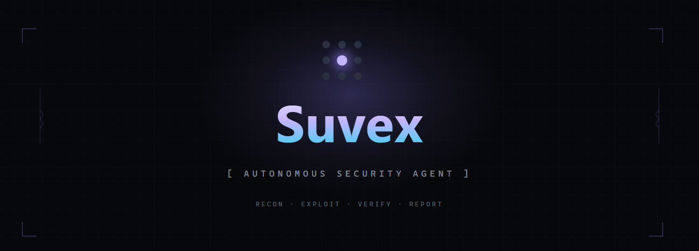
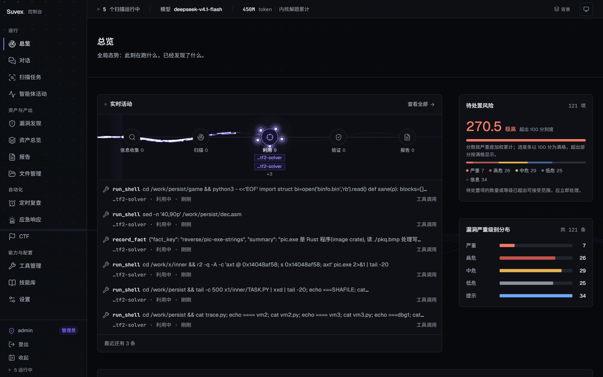
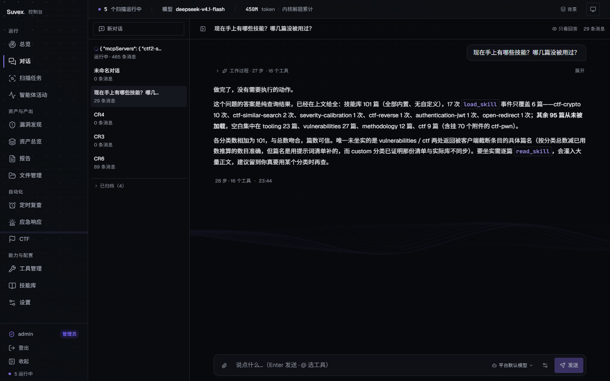
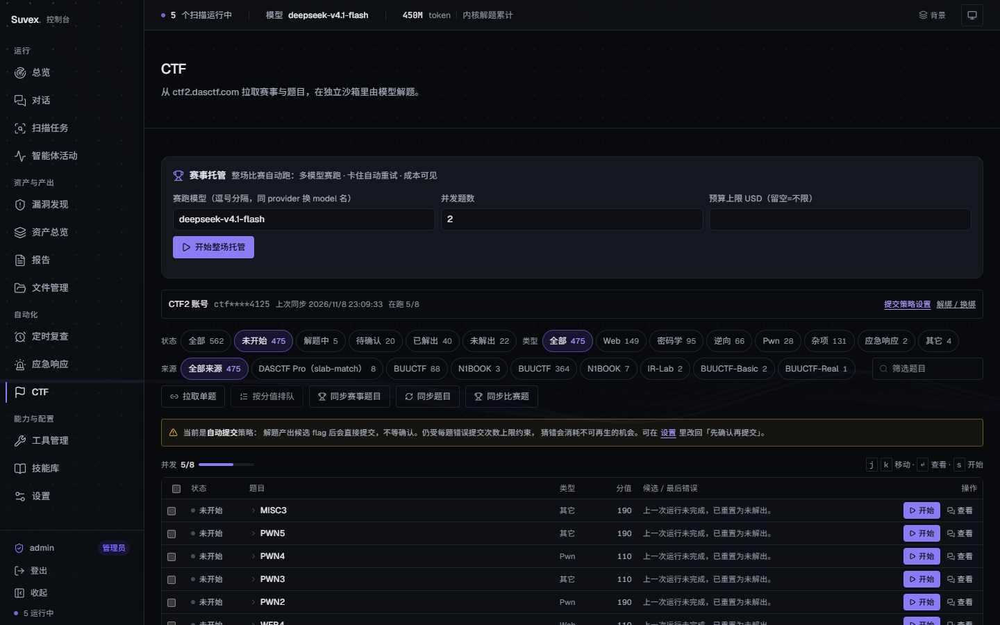
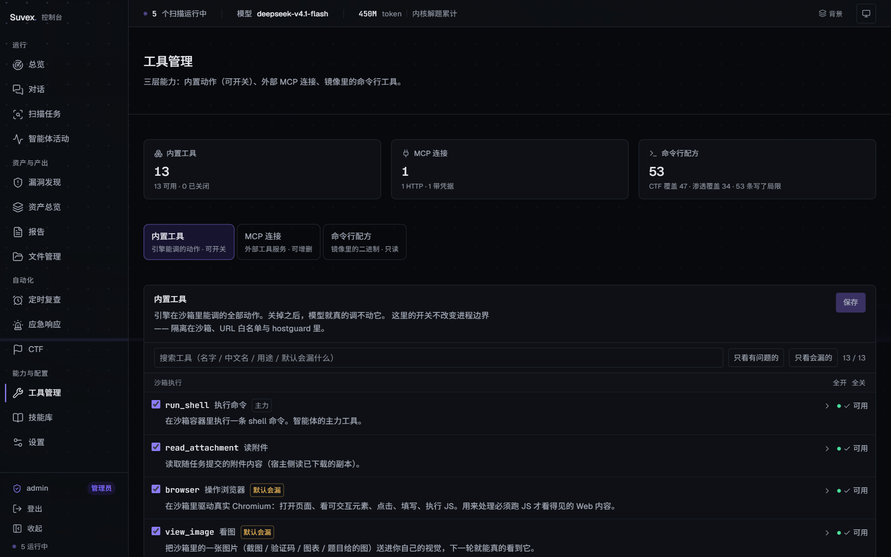
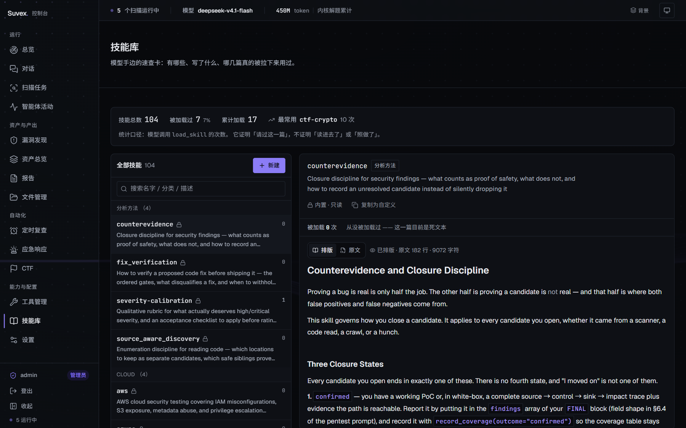
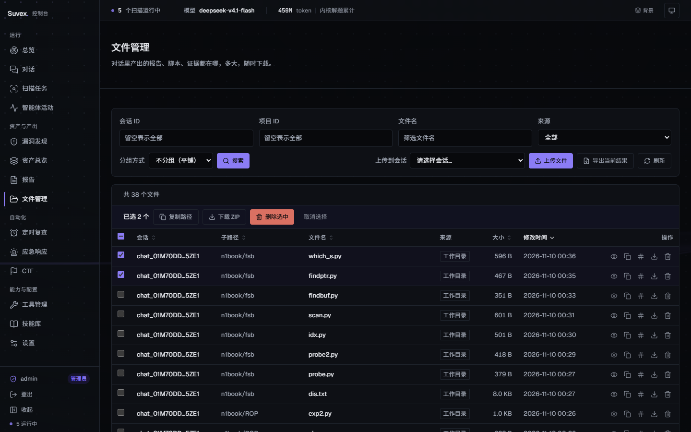
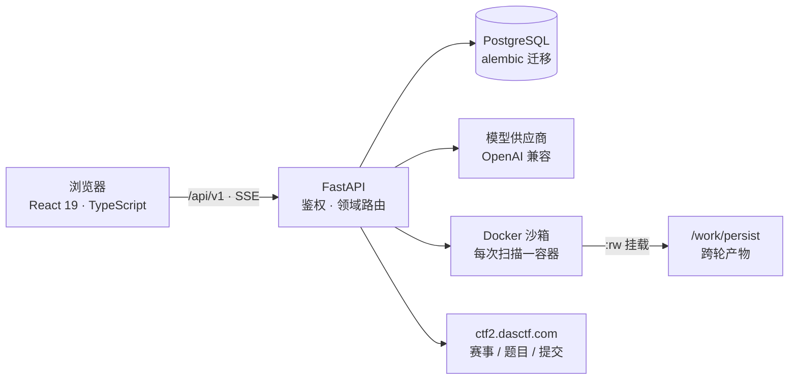

<div align="center">



# Suvex

**一个自治的 AI 安全测试平台**

给它一个目标 —— 网站、代码仓库、TCP 服务、CTF 题目附件 ——
它自己规划、调用工具、验证结论，最后交付一份能直接给人看的报告或题解。

[](https://github.com/Toyar-mo/Suvex/actions/workflows/ci.yml)
[](LICENSE)
[](suvex-api/)
[](suvex-web/)
[](suvex-web/docs/api-contract.md)

</div>

---

## 它是什么

传统扫描器输出的是**漏洞清单** —— 几百条按规则匹配的结果，其中大量是误报，没人知道哪条真的能打通。人工渗透测试输出的是**结论**，但一个人一周只能做一两个目标。

Suvex 的取舍是：**让 agent 像人一样去验证，然后只交付它真的确认过的东西。** 它的核心不是"扫得更多"，而是四件配套的事：

| 机制 | 解决的问题 |
| --- | --- |
| **执行留痕** | 每一次工具调用、推理、发现都进事件流并落库，报告的每条结论都能追到过程 |
| **证据分级** | 区分"确证"与"启发式"，拿不准的标 `needs_follow_up`，**不把猜测写成结论** |
| **判据可配** | `findVulns` / `captureFlag` / `verifyFix`，决定"怎样算成功" |
| **过程可见** | 扫描现场用 SSE 推到前端：舞台、工具卡、逐 token 输出，断线会明说断线 |

## 界面

<div align="center">

<p><sub>总览：实时活动舞台把"哪个智能体在哪个阶段、刚发生了什么"画成一条流动的河 —— 粒子流只在实时连接存活时出现，新事件才触发信号与爆炸</sub></p>
</div>

<div align="center">

<p><sub>对话：模型的每一步工具调用、参数、输出都在这里；技能库统计回答"哪几篇被真正拉下来用过"</sub></p>
</div>

## 两个入口

同一个 agent 内核，两种判据，两种产物。

| | 渗透评估 | CTF 夺旗 |
| --- | --- | --- |
| **输入** | 目标（已部署应用 / Git 仓库 / 本地代码 / TCP 服务）+ 任务背景（范围、账号、注意事项） | 题目附件 + 题面 |
| **成功判据** | `findVulns` —— 确认可复现的漏洞 | `captureFlag` —— 拿到 flag |
| **产物** | 漏洞报告，每条结论都能追到过程 | **题解（Writeup）** —— 一次夺旗的产物是"怎么想出来的"，不是"哪里有洞" |
| **之后发生什么** | 处置工作流：`new` → `confirmed` → `fixed` → `closed`，指派负责人、SLA、按类型分组、附件存证、误报标记 | 候选 flag 交平台校验，解出后回填题解；解题现场留在 `/work/persist` |

第三档判据 `verifyFix` 用于**复测已修** —— 同一套流水线，把"怎样算成功"换成"漏洞是否还在"。

<div align="center">

<p><sub>CTF：从 <code>ctf2.dasctf.com</code> 拉赛事与题目，按分值排队，多模型赛跑，并发与预算都有闸</sub></p>
</div>

> [!NOTE]
> 判据是 `captureFlag` 时，服务端会把 agent 写的报告**重新分节**成题解版式，并把 flag 提到最前面。执行后端的报告标题与分节标题都是写死的渗透口径，所以这一步只能由我们做（详见 `suvex-api/app/scans/writeup.py`）。

---

## 能力版图

### 工具管理：三层能力，各管各的

| 层 | 是什么 | 界面能做什么 |
| --- | --- | --- |
| **内置工具** | 引擎能调的动作（`run_shell`、读附件、浏览器、看图…），关掉之后模型真的调不动 | 开关；不改进程边界（隔离在沙箱、URL 白名单与 hostguard 里） |
| **MCP 连接** | 外部工具服务（HTTP / 带凭据） | 增删、连通性检查 |
| **命令行配方** | 镜像里真实存在的二进制（53 条：CTF 47、渗透 34 有交叠） | 只读；每条标了默认会漏什么、怎么核对 |

<div align="center">

<p><sub>工具管理：13 个内置工具、1 个 MCP 连接、53 条命令配方 —— "装了"与"能用"分开表达</sub></p>
</div>

### 技能库：模型手里那叠速查卡

模型不是靠"知道更多"变强的，是靠**在正确的时刻读到正确的那一篇**。技能库是 89 篇随代码分发的 Markdown（另有自定义技能），模型用 `load_skill` 按需拉取，不需要全塞进上下文。

技能库页回答三个问题：**有哪些、写了什么、哪几篇真的被拉下来用过。**

<div align="center">

<p><sub>技能库：左边清单（按分类分组），右边正文，顶部调用统计 —— 0 次会明写"这一篇目前是死文本"</sub></p>
</div>

> [!IMPORTANT]
> **统计数字的口径必须说清楚，否则它会被读成"有用"。** 它统计的是模型调用 `load_skill` 的次数 —— **能证明"请过这一篇"，不能证明"读进去了"或"照着做了"**。一篇被拉了 3 次却毫无影响的技能，和一个从未被拉过的技能，在这张表上看起来是同一回事。

内置技能在 `suvex-api/prompts/skills/`，随代码分发、**只读**；自定义技能在数据目录，可编辑/删除/新建。三种改动在审计里分开记三条。

### 文件管理：产物在哪、怎么拿走

模型在沙箱里写到 `/work/persist/` 的报告、脚本、证据、截图，会按会话出现在文件管理页：跨会话筛选、分组、上传、下载、按列排序、图片/文本在线预览、批量选择、**批量删除**，以及**一次请求把选中文件打成 ZIP**（`{sessionId}/{path}` 条目名，跨会话同名不覆盖）。

<div align="center">

<p><sub>文件管理：表头可排序，勾选后可复制路径、下载 ZIP 或批量删除；每行还能预览、复制、下载、删除</sub></p>
</div>

### 其余

- **扫描任务**：91 次运行记录，排队 / 运行 / 完成 / 失败 / 已终止，全部可下钻到事件流。
- **资产与漏洞**：资产总览、漏洞发现、攻击链、附件存证、误报标记。
- **定时复查 / 应急响应**：周期任务与剧本包。
- **报告**：每条结论带过程引用；导出前可核对证据等级。

---

## 架构



- **控制面与执行面分离**：API 进程不跑目标；扫描在独立容器里，跑完即销毁。
- **契约唯一事实来源**：[`suvex-web/docs/api-contract.md`](suvex-web/docs/api-contract.md)，4,090 行。
- **事件流**：SSE + 断线重放（`Last-Event-ID`），前端不轮询扫描详情。

## 快速开始

### 后端

```bash
cd suvex-api
python -m venv .venv && . .venv/bin/activate
pip install -r requirements-dev.txt
cp .env.example .env                 # 生成 SUPEX_SECRET_KEY：python -m app.core.crypto
alembic upgrade head
uvicorn app.main:app --reload        # http://127.0.0.1:8000
```

> [!NOTE]
> **API 文档页默认是关的。** `SUPEX_EXPOSE_DOCS` 默认 `false`，`/api/v1/docs` 返回 **404** 是刻意的：那份文档描述全部端点与出入参，默认不该暴露。要在本机看，设成 `true` 再重启。契约本身始终可读。

### 前端

```bash
cd suvex-web
npm install
npm run dev                          # http://localhost:5173
```

前端默认请求**当前页面的 origin**，由 Vite 的 `server.proxy` 把 `/api` 转发到后端。换地址、换机器都不需要改配置；同源请求，没有 CORS 问题，Cookie 也一定带得上。

> [!WARNING]
> **Vite 开发服务器只能监听 `127.0.0.1`，不要用 `--host 0.0.0.0`。**
> `vite.config.ts` 的 `server.host` 已固定为环回地址；但命令行/SYSTEMD 的
> `--host 0.0.0.0` 会覆盖它。5173 没有鉴权，且会把 `/src/`、`/docs/`、
> `vite.config.ts`、sourcemap 直接暴露给访问者。对外请只暴露 nginx 托管的
> `dist/`（生产构建），不要把这个 dev server 写进默认服务单元。
> 需要本机开发服务时，用仓库里的 `deploy/systemd/suvex-web.service` 模板
> （已固定 `--host 127.0.0.1`），不要手写 `0.0.0.0`。

### 真机部署（要真跑扫描，只有这一条路）

`docker compose` 起的是**控制面**，跑不了扫描（镜像里没有 `strix` 与 docker CLI）。要执行扫描，用一台装了 Docker 的 Linux 宿主机：

```bash
sudo bash suvex-api/deploy/install.sh --dry-run   # 先看会做什么
sudo bash suvex-api/deploy/install.sh
```

覆盖专用用户、docker 组、锁文件安装、systemd、nginx 反代、日志与备份。装完按部署文档验收。

---

## 当前状态（如实说）

> 这一节不是宣传文案。已做到的附数字与口径，没做到的如实列出。

### 规模（2026-11-10 实测）

| 项 | 数字 |
| --- | --- |
| 后端代码 | **92,488 行** / 178 个文件（`suvex-api/app/`） |
| 后端测试 | **208 个测试文件 / 3,423 个 `def test_`**（静态计数） |
| 前端代码 | **90,783 行** / 307 个 `.ts`/`.tsx`（`suvex-web/src/`） |
| 前端测试 | **87 个文件 / 1,263 passed**（`npm test`，32.9 秒） |
| 数据库迁移 | 67 个 Alembic 版本 |
| API 端点 | 171 个（按 `@router.*` 装饰器计） |
| API 契约 | 4,090 行 |
| 决策记录 | 10 篇 ADR（`suvex-api/docs/adr-*.md`） |
| 技能库 | 89 篇随仓库分发 |
| 页面 | 26 个 |

> [!WARNING]
> **数字要带口径，否则不如不写。** 后端测试写的是**静态 `def test_` 数**；参数化展开后的执行数更多，最近一次全量执行记录是 2,432 passed / 3 skipped（2026-10-17，对真实 PostgreSQL，42 分 35 秒）。2026-11-10 没有重跑全量后端套件 —— 前端 1,263 是本次实测，后端 3,423 是静态计数，两者不是同一种量法。

### 真机验证过的

* 扫描编排 → 真 strix 子进程 → Docker 沙箱 → 事件导入，链路全通
* 单次扫描观测到 **936 条**事件，`agentCount` 从 0 涨上去
* CTF2 判题引擎实际解出过题目，flag 落库
* 同时 5 道题解跑、实时活动舞台、SSE 断线重连
* 文件管理：上传 → 列表 → 批量选择 → ZIP 导出 → 批量删除（含真实删除回执）

### 已经补上的

* CI（后端 ruff + 测试 / 前端检查 / 仓库卫生）
* LICENSE：Apache 2.0，含专利授权
* 501 清零、契约两轮专项对账
* 多用户与两档角色（管理员 / 只读），含防自锁
* CTF 解题现场保留（`/work/persist`，修好了容器内 uid 1000 的写权限）
* 扫描产物保留策略（归档 → 回收站 → 过期清理）
* 文件管理：跨会话清单、截断如实上报、批量删除、ZIP 导出
* 后端 ruff 接进 CI

### 还没有做到的

| # | 缺口 | 影响 |
| --- | --- | --- |
| 1 | **多用户是单租户的** | 多个账号共享全部数据。真多租户要给每张业务表加 `tenant_id` 并改所有查询 —— 而且 Suvex 会对任意目标发包，做 SaaS 意味着要为**别人**的目标负责，那是合规问题 |
| 2 | **`/metrics` 不覆盖依赖注入抛出的 401/403** | 路由层状态码都计数，鉴权失败经异常处理器生成的不计（见 `test_metrics.py` 里钉住局限的用例） |
| 3 | **前端页面级测试仍然少** | 26 个页面，测试主要落在组件与纯逻辑；渲染期崩溃仍可能只有人工点开页面才发现 |
| 4 | **续解会丢"装到一半的工具"** | 镜像外 `pip install` / `apt` 装的包不在持久区，跨轮丢失。暴露面不大（史库里 38 次解题只续解过 1 次），但确实存在 |
| 5 | **方法卡效果未经对照实验验证** | 首次 A/B 对照 n=1：两组都跑满 40 轮、都未解出，过程指标差异很小 —— 没有观察到正向信号，但 n=1 不构成结论 |
| 6 | **依赖锁定靠 pip-tools，不是 uv** | 这是选型不是缺口。风险是"改了声明却忘记重新生成锁文件"，现在由 `verify_lockfiles.py` 在 CI 拦着 |

> [!NOTE]
> 这份清单不粉饰，也不重复列已修项。缺过什么本身是信息，但已修的就不再占一行。

---

## 设计原则

### 1. 宁可少说，不说错的

拿不到 flag 就写"本次没有确认到 flag"，而不是猜一个；证据分级里 `ruled_out` 必须附具体反例，"感觉应该没问题"一律记 `needs_follow_up`。

### 2. 失败要说人话，并且给出下一步

续跑失败不能只说"会话文件已不在" —— 必须补上"请改用「重跑」"。

### 3. 同一件事实只能有一个出处

筛选条件、状态流转表、枚举词汇表都只有一份实现。两份口径迟早漂移，而漂移的症状用户无法解释，只能不再相信界面。

### 4. 凭据只走环境变量

`.env` / `_uploads/` / `_scan_runs/` 全部不入库。`_uploads/` 尤其重要：附件是用户业务数据（内网截图、抓包），可能含拓扑甚至令牌。

### 5. 注释写"为什么"，不写"是什么"

代码本身说清了是什么；注释留下的是当时的取舍与踩过的坑。所以你会看到大量"⚠️ 这里曾经……"的记录 —— 那是给下一个改这段代码的人看的。

### 6. 过程性文档不入库

交接文档、审查报告、工作单的保质期与代码不同步：改代码时没人记得去改，过期后静默变错却仍像权威。需要交付时走交付目录，不要 `git add -f` 绕开 `.gitignore`。

### 7. 不做与本次改动无关的修改

`ruff format` 会让整个仓库变红，项目只用 `ruff check`。顺手格式化会产出几十个无关文件的 diff，把真正的改动淹没在里面。

---

## 目录结构

```
suvex-api/
  app/core/       跨领域公共件（依赖方向单向）
  app/{auth,providers,scans,findings,reports,events,settings,members,audit,overview,chat,ctf2,kernel}/
                  按领域拆分：模型 / 出入参 / 业务 / 路由
  alembic/        67 个迁移
  tests/          208 个测试文件，对真实 PostgreSQL 跑
  docs/           10 篇 ADR + 安全清单 + 验收记录
  docker/         CTF2 沙箱镜像（base / re 两个 profile）
  prompts/skills/ 89 篇内置技能（只读）

suvex-web/
  src/data/       数据模型与数据源（全部走真实 API）
  src/pages/      26 个页面（Landing 同步引入，其余 lazy 分包）
  src/components/ 布局壳 / 各功能页组件 / 无状态基础件
  src/design-system.md   配色 / 字体 / 间距 / 动效的决策与理由
  docs/api-contract.md   ★ 契约，唯一事实来源
```

各子项目自己的 README 有更细的说明：
[`suvex-api/README.md`](suvex-api/README.md) · [`suvex-web/README.md`](suvex-web/README.md)

---

## 关于这份 README

* 数字口径写在「当前状态」里；代码在动，数字会漂，**以实测为准**。
* 截图来自真机（Kali，systemd + 宿主 venv，2026-11-10），不是设计稿。
* 「设计原则」「还没有做到的」是真实记录，不是模板。改过之后请如实更新。
* 仓库根下不放过程性文档；本地副本未跟踪，不要 `git add`。
