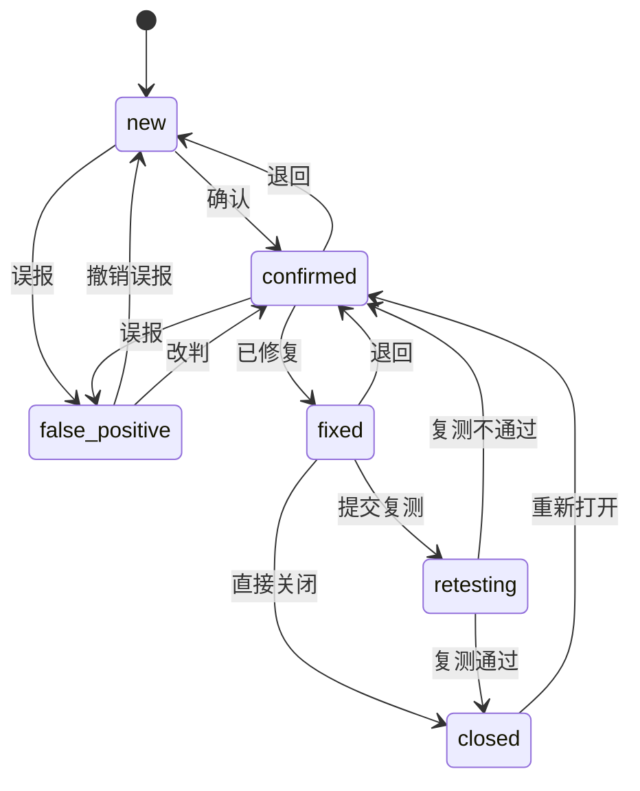

# 漏洞发现：批量处置与工作流设计（任务 10）

> 状态：**设计稿，未实施**。按项目既有规则，契约先改、代码后改。
> 本文只回答三件事：状态机怎么定、要加哪些接口、分几期做。

---

## 1. 现状盘点（先看清已有什么，避免重复造）

需求背景写的是"已有 checkbox 多选列，但未接入任何批量操作"。**实测与此不符** ——
批量链路其实已经通了，缺的是工作流那一层。逐项核对：

| 能力 | 现状 | 位置 |
| --- | --- | --- |
| 批量状态流转 | ✅ **已有** | `POST /findings/status`（`ids` / `status` / `note`） |
| 状态机服务端校验 | ✅ **已有** | `core/vocab.FINDING_STATUS_TRANSITIONS` |
| 逐条变更历史 | ✅ **已有** | `finding_timeline` 表，含 `from_status` / `to_status` / `actor` |
| 审计留痕 | ✅ **已有** | `AuditAction.FINDING_STATUS_CHANGE` |
| 前端批量栏 | ✅ **已有** | `components/findings/BulkActionBar.tsx` |
| 列表筛选 | ✅ 已有 severity / status / category / q / scanId / sort / dir | `GET /findings` |
| 统计角标 | ✅ 已有 | `GET /findings/stats` |
| 复测中 / 已关闭 | ❌ 只有 4 个状态 | — |
| 指派 / 负责人 | ❌ 无字段、无接口 | — |
| SLA / 到期 | ❌ 无 | — |
| 附件 / 截图 | ❌ 无 | — |
| 分组视图 | ❌ 无 | — |
| 漏洞软删除 | ❌ 无（扫描模块有） | — |
| 按 target / 时间范围筛选 | ❌ 无（只有模糊搜索 `q`） | — |
| 报告联动（按漏洞选） | ❌ `ReportScopeIn.kind` 只有 `scan` / `target` / `range` | — |
| 导出 CSV/PDF | ❌ 漏洞维度没有 | — |

**结论：本期是"在工作流上加层"，不是"从零做批量"。** 这决定了实施顺序 ——
底层的批量流转与时间线已经可靠，可以在它上面直接叠指派与 SLA。

### 1.1 一处需要澄清的措辞

需求 §一.2 要求「即使是批量操作也要逐条落库，不能只存"批量操作"这一条粗粒度日志」。

现状是**两层**，而不是一层：

| 层 | 粒度 | 内容 |
| --- | --- | --- |
| `finding_timeline` | **逐条** ✅ | 每条漏洞各有一行：谁、何时、从什么状态到什么状态、附注 |
| `audit_log` | **每次操作一行** | 一条记录含 `changedIds` 全部 id + `targetStatus` + 操作人 + IP |

也就是说**逐条留痕已经存在**，审计那条粗记录是**额外的**、不替代 timeline。
审计表刻意不逐条写：一次批量 500 条会产生 500 行审计，而审计的价值在于
"每一次操作对应一条可追溯的动作"，把它摊成 500 行反而淹没真正的操作序列。

**如果要求的是"审计表也逐条"，可以做，但请先确认** —— 见 §6 待决策 1。

---

## 2. 状态机设计

### 2.1 现状（4 状态）

```
new ──→ confirmed ──→ fixed ──→ confirmed（只能退回）
 │           │
 └───────────┴──→ false_positive ──→ new / confirmed
```

### 2.2 扩展后（6 状态）



### 2.3 流转表（服务端唯一事实来源）

| from | 允许到 | 变化 |
| --- | --- | --- |
| `new` | `confirmed`, `false_positive` | — |
| `confirmed` | `fixed`, `false_positive`, `new` | — |
| `fixed` | **`retesting`**, **`closed`**, `confirmed` | 新增两个出口 |
| **`retesting`** | **`closed`**, `confirmed` | 新状态 |
| **`closed`** | **`confirmed`** | 新状态 |
| `false_positive` | `new`, `confirmed` | — |

### 2.4 三个设计决定及理由

**① 复测环节是可选的两条路，不是强制关卡。**

`fixed → closed` 直达，或 `fixed → retesting → closed`。需求原文写的是
"已修复 → 复测中 → 已关闭（**如需要**复测环节）"——"如需要"三个字说明它不该是
唯一路径。强制经过复测的代价是：一条明显修好的漏洞（比如改了个响应头）
也要多走一次状态流转，用户会开始乱点。

`retesting` 的语义是**"正在验证修复效果"**，它是一个进行中的标记，
不是一个审批节点。

**② `closed → confirmed` 允许重新打开。**

漏洞会复发，修复也会不彻底。没有回路的终态会逼用户把"重新打开"记成
一条新记录 —— 而那会切断历史，让"这条漏洞反复出现过几次"变成一个
查不出来的问题。

**③ 保留 `fixed → confirmed` 这条既有回路。**

现在的代码注释写得很清楚：一条修复过的漏洞如果其实是误报，应该先退回确认，
让"修复"这个动作保持可追溯。这条不回退。

**兼容性**：老数据只有 4 种状态，新增两个状态不影响它们。
`fixed` 的记录多出两条出口，是纯增量。

---

## 3. 后端接口清单

### 3.1 复用（不改）

`GET /findings/{id}`（详情 + timeline）

### 3.2 扩展（同一路径，加参数/加校验）

| 接口 | 加什么 | 为什么 |
| --- | --- | --- |
| `GET /findings` | `target`、`assigneeId`、`discoveredFrom`、`discoveredTo` | 需求 §五.1：目标一多，模糊搜索不够用 |
| `GET /findings/stats` | 与列表**同一套**筛选参数 | 需求 §七.3：角标要随筛选联动。★ 必须由后端算，不能用列表长度代替 —— 契约把 stats 定为"唯一数据源"，Overview 也读它 |
| `POST /findings/status` | ① `status=false_positive` 时 **`note` 必填**（长度下限）② 变更后重算 SLA 时钟 | 需求 §一.3：误报必须有说明，便于复盘误报率 |
| `GET /findings/{id}` | 响应加 `assignee` / `sla` / `attachments` / `allowedTransitions` | 前端不必再维护一份流转表 |

> ★ `allowedTransitions` 值得单独说：现状前端自己判断哪些按钮可点
> （`BulkActionBar` 里遍历全部状态 + 数据层幂等跳过）。状态涨到 6 个之后
> 这套逻辑会漂移。**由后端返回合法目标**，前端只渲染 —— 双保险里的
> 第一道（服务端校验）不变，第二道不再手抄。

### 3.3 新增

| 接口 | 用途 | 备注 |
| --- | --- | --- |
| `POST /findings/assign` | 批量指派 | `{ids, assigneeId \| null}`，`null` = 取消指派 |
| `GET /members` | 处理人名单 | |
| `POST /members` | 新增处理人 | |
| `PATCH /members/{id}` | 改名 / 停用 | 停用而非删除：历史指派要能显示名字 |
| `GET /settings/finding-sla` | SLA 规则（singleton） | `{criticalDays, highDays, mediumDays, lowDays, infoDays, startFrom}` |
| `PUT /settings/finding-sla` | 改规则 | 与 `scan-retention` 同一模式 |
| `GET /findings/groups` | 按漏洞类型聚合 | 返回 `{title, severity, category, instanceCount, targets[], statusBreakdown}` |
| `POST /findings/batch/delete` | 软删除 | 与扫描模块**同一交互**（回收站 + 撤销） |
| `POST /findings/batch/restore` | 恢复 | |
| `DELETE /findings/{id}/purge` | 永久删除 | 被报告引用时要挡（同 `purge_scan`） |
| `POST /findings/{id}/attachments` | 上传处置证据 | 图片 / PDF，大小上限 |
| `GET /findings/{id}/attachments` | 列表 | |
| `DELETE /findings/{id}/attachments/{aid}` | 删除 | |
| `GET /findings/export` | `?format=csv` | PDF 复用报告的浏览器打印路径 |
| `GET/PUT /settings/finding-views` | 我的视图 | 与 `scan-views` 同模式，或抽成通用 |

### 3.4 报告联动（打通两个模块）

`ReportScopeIn.kind` 增加 `"findings"`，配套 `findingIds: list[str]`：

```jsonc
{
  "title": "客户A 复测报告",
  "scope": { "kind": "findings", "findingIds": ["f_01...", "f_02..."] },
  "options": { ... },
  "format": "pdf"
}
```

漏洞页的「导出报告」把选中 id 通过 URL 传给报告页（`/reports?findings=f1,f2`），
报告页预填这些条目 —— 用户不需要在报告页重新勾一遍。

`ReportScopeIn` 的 `_exactly_one_shape` 校验要同步加一支（现在校验
scan/target/range 三选一）。

### 3.5 数据模型变更

```
findings
  + assignee_id      String(64) NULL    -- FK members.id，ON DELETE SET NULL
  + assigned_at      UtcDateTime NULL
  + sla_due_at       UtcDateTime NULL   -- 冗余存储，便于索引与排序
  + closed_at        UtcDateTime NULL
  + deleted_at       UtcDateTime NULL   -- 软删除，与 scans 一致
  + updated_by       String(64) NULL

members                              -- 新增表
  id, name, email NULL, active, created_at

finding_attachments                  -- 新增表
  id, finding_id FK CASCADE, filename, content_type,
  size_bytes, stored_path, uploaded_by, uploaded_at

finding_sla_config                   -- 新增表（singleton，同 scan_retention_config）
  id, critical_days, high_days, medium_days, low_days, info_days,
  start_from('discovered'|'confirmed'), updated_at
```

**`sla_due_at` 冗余存储的理由**：到期提醒要能排序、要能筛"临期/超期"，
每次查询都现算 `discovered_at + days` 就没法用索引。它由后端在
「创建 / 状态变更 / 规则变更」三个时机重算并落库 —— **前端永远不算 SLA**。

---

## 4. 分阶段实施计划

按你建议的顺序（批量确认/误报 → 指派 → SLA → 分组 → 报告联动），
但**前置一个 P0**：状态机与契约必须先行，否则后面每期都要回头改契约。

| 期 | 内容 | 交付物 | 依赖 |
| --- | --- | --- | --- |
| **P0** | ✅ **已完成** —— 契约 v0.14；6 状态与流转表；误报理由必填。（`allowedTransitions` 并入 P1：它要改 `GET /findings/{id}` 的响应形状，与列表列改动同期做更省事。**不需要 alembic 迁移** —— `status` 本来就是 `String(16)` 列，新增枚举值不动表结构。） | `api-contract.md`、`vocab.py`、`reports/document.py`、`finding.ts` 及 6 处前端联动、3 处测试修正 | — |
| **P1** | ✅ **已完成** —— 误报理由弹窗（`ReasonDialog`，单条与批量共用）、**toast 可撤销**（删掉原来那块 2.5 秒消失、不可撤销的页面内提示条）、`runTransition` 统一出口。⚠️ 撤销**带合法性判断**：状态机不对称（`closed` 回不到 `fixed`），全部能回才给撤销按钮 —— 给一个点下去会 400 的撤销比不给更糟。 | 前端 | P0 |
| **P2** | ✅ **已完成** —— `members` 表 + 迁移 `822b63652b4e`、`/members` CRUD、`/findings/assign`、列表「负责人」列、按负责人筛选（含「未指派」）。 | 后端 + 前端 | P0 |
| **P3** | ✅ **已完成** —— `finding_sla_config` 表 + 迁移 `6d1460fcd7b4`、按严重度的天数（`0` = 不设时限）、`startFrom` 可配、三个重算时机 + **启动自愈回填**、列表 `dueAt`/`slaState`/`slaDaysLeft`（后端判定）、`SlaBadge` 与时限筛选。 | 后端 + 前端 | P2 |
| **P4** | ✅ **已完成** —— `/findings/groups` 按标题聚合、列表/分组切换、组内批量确认（「整组确认」**只在全组状态一致时**给，否则会覆盖别人已做过的判断）。 | 后端 + 前端 | P0 |
| **P5** | ✅ **已完成** —— 报告 scope 新增 `kind="findings"`（迁移 `c8a41d6e9307` 开放两条 CHECK 约束）；漏洞页「生成报告」→ `/reports?findings=...` → 报告页惰性初始化接住。 | 后端 + 前端 | P0 |
| **P6** | 细节：统计随筛选联动、空状态引导、附件、漏洞软删除、报告导出 CSV/PDF | 前后端 | P0 |

> ### ⚠️ 实施中发现的 v0.14 遗留缺陷（P3 的实测暴露）
>
> 状态机从 4 个扩到 6 个时，改了三处（`vocab`、前端 `finding.ts`、报告标签），
> **漏了两处**，而它们都在"看起来不像状态机定义"的位置：
>
> 1. `findings/schemas.py` 的 **`StatusLiteral`** —— 它是
>    `POST /findings/status` 的请求体类型，于是「提交复测」「关闭」
>    被 pydantic 拦成 **422**。
> 2. 数据库上的 **`ck_findings_status_valid`** —— 它只允许 4 个值，
>    于是 `closed` / `retesting` **根本存不进去**（撞 CHECK，500）。
>    这比第 1 条更严重：`Literal` 至少会在到达数据库之前拦下来。
>
> 两处都已修正（含迁移 `b1f7c0a25e38`）。教训是：**跨层的枚举，
> 唯一事实来源应该是 `vocab`** —— 那两个地方都是"抄了一份"，
> 而抄的东西必然漂移。当时的对账脚本只比对了 `vocab` 与前端。

**每期的验收口径**（与既有模块拉齐）：

- 后端：pytest 覆盖新增流转（非法流转 400、幂等跳过、误报无理由 400）；
  真机请求验证，不只看单测
- 前端：`typecheck` / `lint --max-warnings 0` / `verify:contract` / `build` 全绿；
  **真机点一遍**（本项目已经吃过"单测全绿但界面上写操作全 403"的亏）
- 契约：先改 `api-contract.md` 再改代码（项目既有规则）

---

## 5. 交互一致性（技术约束的落地）

需求明确要求与"扫描任务"模块保持一致。可直接复用扫描模块已经建好的件：

| 件 | 位置 | 复用到漏洞页 |
| --- | --- | --- |
| Toast + 撤销 | `data/toast-store.ts`、`ui/Toast.tsx` | ✅ 直接复用（5 秒 undo 窗口） |
| 确认对话框 | `ui/ConfirmDialog.tsx` | ✅ 软删除 / 永久删除 |
| 选择框 | `ui/Checkbox.tsx` | ✅ 已有 |
| 我的视图 | `lib/scan-view-query.ts` + `data/scan-views.ts` | ⚠️ 键名与端点不同，建议抽公共实现或按同一模式复制 |
| 浮动栏 | `components/scans/BulkActionBar.tsx` | ⚠️ 交互模式照搬，组件不复用（字段不同） |

**必须保持一致的三点**（否则用户在两页之间会产生错误预期）：

1. 批量动作**立即执行**，用 toast 给 5 秒撤销窗口 —— 只有**删除**才先问一遍
2. 成功/失败**都清空选择**
3. 失败用 `tone: 'risk'`，与"已完成"区分

> ⚠️ 现状漏洞页用的是自定义 `feedback` 条（2.5 秒消失、**不可撤销**），
> 与扫描页的 toast 模式不一致。P1 要改掉。

---

## 6. 决策记录

### 6.1 已定（2026-09-25）

**1. 审计粒度：保持现状 —— `finding_timeline` 逐条 + `audit_log` 每次操作一条。** ✅

理由见 §1.1：逐条留痕已经存在，审计那条粗记录是**额外的**而非替代。
批量 500 条若也逐条写审计，会把"一次操作"这个语义摊成 500 行，
反而淹没真正的操作序列。审计的价值在于**每一次操作对应一条可追溯的动作**。

**2. 负责人来源：维护 `members` 成员名单表。** ✅

系统只有一个登录账号（`/auth/setup` 一次性初始化），所以指派对象**不是登录用户**。
用名单表而不是自由文本的理由：按负责人筛选才不会被错别字撕成好几组；
成员停用而非删除，历史指派仍能显示名字。

### 6.2 待决策（先按推荐默认执行，不同意再说）

**3. 复测环节强制吗？** → 默认**两条都留**（`fixed → closed` 直达 + `fixed → retesting → closed`），
理由见 §2.4 ①。

**4. SLA 从哪个时刻起算？** → 默认**可配**（`start_from`），默认 `discovered_at`。
按确认时间起算对"确认得晚"的团队更公平，但那是个策略选择，交给配置。

**5. SLA 到期后做什么？** → 默认**只做视觉提醒**（红色倒计时 + 筛选）。
要接邮件/webhook 通知的话是另一块工作量（复用已有通知渠道）。

**6. 附件存哪？** → 默认**本地磁盘 + 数据库存元信息**，与 strix 产物同一思路。
单机自托管场景下，把图片塞进数据库会让备份膨胀得很快。

**7. 漏洞能否删除？** → 默认**允许软删除**，与扫描模块对齐
（回收站 + 到期清理 + 被报告引用时挡住永久删除）。
"被报告引用的漏洞"需要一个处理策略 —— 沿用 `purge_scan` 的 409 + 指名报告做法。

